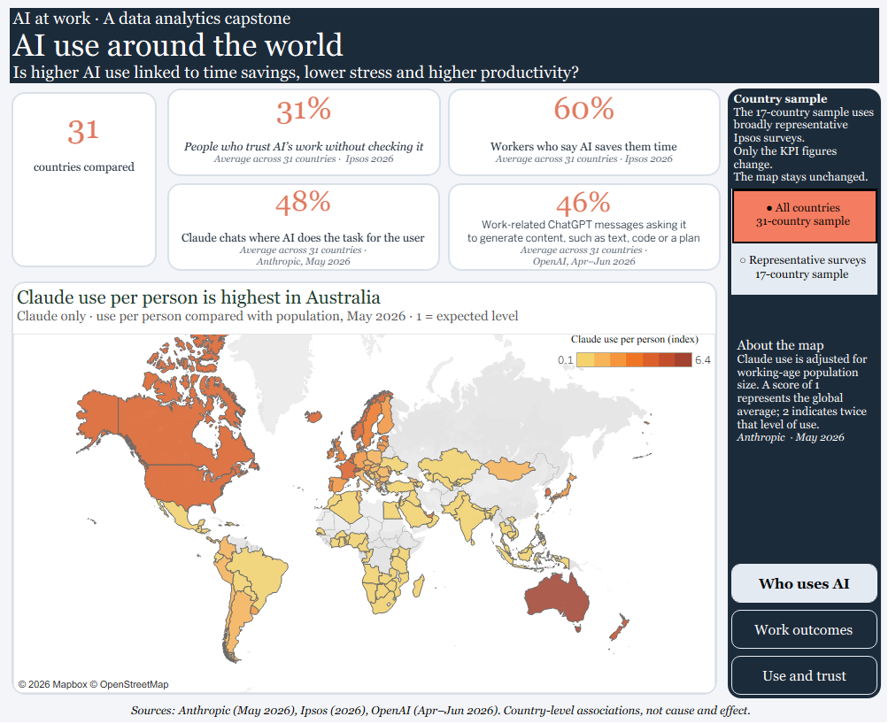
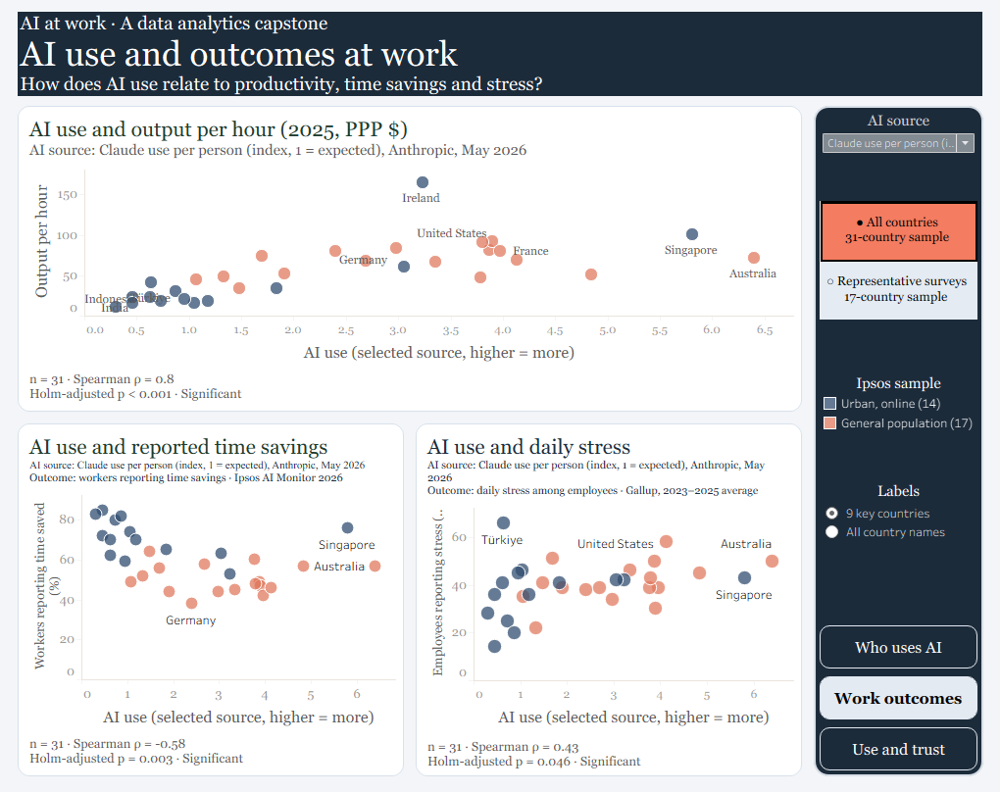
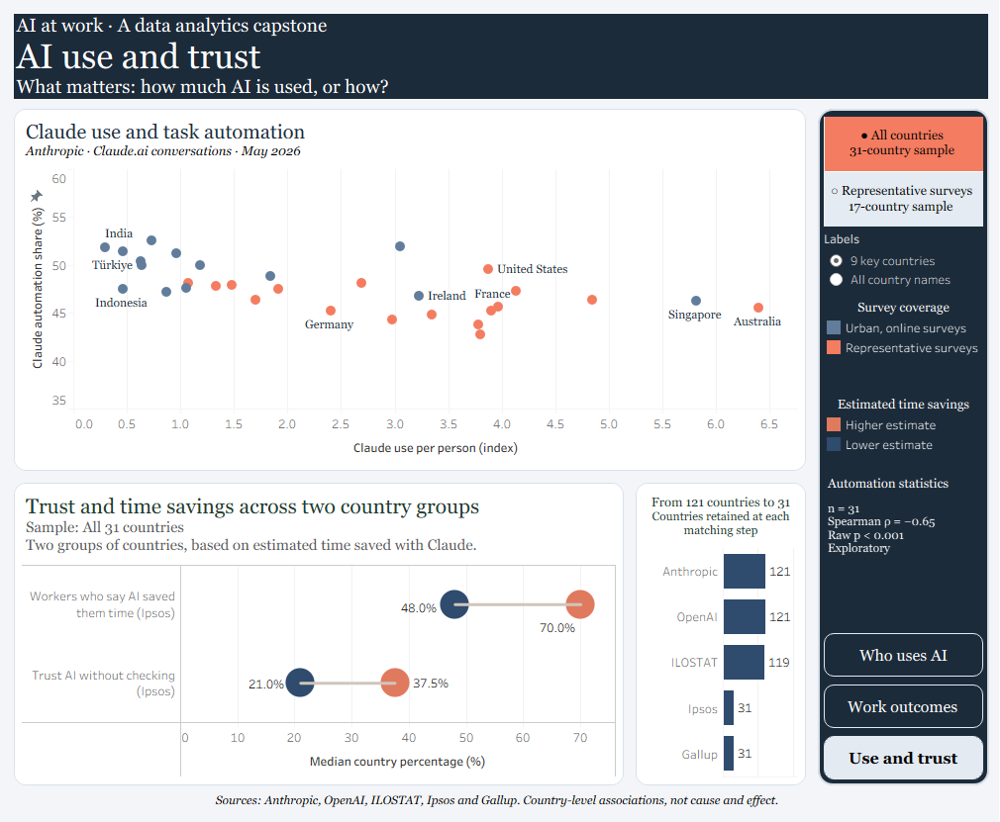

# AI at work: time savings, stress and productivity

## In countries where people use AI more, do workers save time, feel less stressed, and produce more per hour?

I wanted to see whether the growing use of AI is reflected in the way people experience work. I combined six country-level sources, cleaned and matched them in Python using Google Colab, and compared 31 countries. Then I repeated the analysis for 17 countries whose Ipsos surveys were broadly representative of adults. The results are presented in three connected Tableau dashboards.

**Live dashboard:** [AI at Work: Time Savings, Stress and Productivity](https://public.tableau.com/app/profile/crinu.topalo6593/viz/AIatWorkTimeSavingsStressandProductivity/WhousesAI)

## What I found

The answer was mixed. In the full 31-country sample, countries with higher AI use tended to have higher output per hour, but a lower share of workers reporting time saved. There was no consistent link with lower stress. The productivity pattern was similar across the three AI-use measures, with correlations between **0.79 and 0.82**. For reported time saving, the correlations were between **−0.55 and −0.58**. This does not mean that AI makes individual workers slower, or that it caused the productivity differences.

The picture changed when I repeated the comparison for the 17 countries with broadly representative Ipsos adult surveys. None of the nine main comparisons remained statistically significant after Holm correction. This does not prove that there is no relationship. It shows that the findings depend on which countries are included, with both the smaller sample and its different composition affecting the comparison.

I also looked beyond how much AI is used. Countries with higher estimated task-time reductions in Claude tended to report more time saving and greater trust in AI without checking its work. However, Claude's estimates and the survey answers come from different populations. They do not show that the surveyed workers experienced those estimated savings, and greater trust without checking is not necessarily a better outcome.

A separate exploratory comparison found that greater Claude use per person was associated with a lower share of chats classified as automation: **rho = −0.65, raw p < 0.001** across 31 countries. The relationship was weaker and not statistically significant across 17 countries (**rho = −0.35, raw p = 0.171**). Automation share and estimated time saving are different measures; neither tells us how many jobs AI replaces.

Overall, more AI use did not give a clear answer about better work outcomes. The way AI is used may be worth examining alongside adoption, but this analysis does not establish which matters more. These findings raise questions for further investigation, rather than showing that greater AI use leads to more time saved, less stress or higher productivity.

## A closer look at the dashboards

### 1. Who uses AI

The first page gives an overview of Claude use per person and the average country indicators. The map covers **121 countries** and remains fixed when the sample changes. A value of 1 on the Claude index means the expected level relative to population; 2 means twice that level.

The KPI cards are unweighted averages of country percentages. For the 31-country sample, they show **31%** for trust without checking, **60%** for reported time saving, **48%** for Claude automation and **46%** for ChatGPT doing among work-related messages. They are not pooled estimates for all workers worldwide.



### 2. Work outcomes

The second page compares AI use with output per hour, reported time saving and daily stress. The AI-source selector switches the x-axis between Claude use per person, OpenAI's reversed per-capita rank and Microsoft's adoption estimate. The sample buttons switch between 31 and 17 countries. Each chart shows its country count, Spearman coefficient and Holm-adjusted p-value.

The label option changes country names without removing dots. The different source units mean that the x-axis scale changes with the selected AI measure.



### 3. Use and trust

The third page looks at how AI is used. The upper chart compares Claude use per person with the share of chats classified as automation. The lower chart compares trust and reported time saving across two groups of countries, split by estimated task-time reduction in Claude.

The dumbbell chart shows median country percentages. In the full sample, the higher-estimate group had a median **70%** reporting time saved, compared with **48%** in the lower group. Median trust without checking was **37.5%** versus **21%**. These are descriptive group comparisons, not tested causal effects. The matching chart stays fixed because it explains how the study's country comparison was assembled.



## Data sources

| Source | What I used | Period |
| --- | --- | --- |
| [Anthropic Economic Index](https://huggingface.co/datasets/Anthropic/EconomicIndex/tree/main/release_2026_06_26) | Claude use per person, automation, work share, autonomy and estimated task-time reduction | May 2026 |
| [OpenAI Signals](https://openai.com/signals/data-download/) | Per-capita usage rank and work/doing message shares | Apr–Jun 2026 |
| [Microsoft via Our World in Data](https://ourworldindata.org/grapher/estimated-share-people-generative-ai) | Estimated generative-AI adoption among working-age adults | March 2026 |
| [ILOSTAT](https://ilostat.ilo.org/topics/labour-productivity/) | Output per hour, constant 2021 international dollars at purchasing power parity | 2025 |
| [Ipsos AI Monitor](https://www.ipsos.com/en-uk/global-attitudes-ai-2026-wonder-vs-worry-divide-deepens) | Trust without checking and workers reporting time saved | 2026 |
| [Gallup State of the Global Workplace](https://www.gallup.com/file/workplace/707798/state-of-the-global-workplace-2026-download.pdf) | Employee daily stress | Pooled 2023–2025 |

The large raw files and source reports are not included. Download them from the providers above. The original Anthropic CSV is about 209 MiB; its country-only extract is about 81 MiB. The small cleaned tables used for the analysis are included under `data_clean/`. Ipsos and Gallup values were transcribed for the selected countries and are preserved in `survey_values.csv`. Provider attribution and reuse terms still apply to their material.

## How the analysis works

### Cleaning and matching

I standardised country identifiers to ISO-3, selected the intended periods and metrics, and joined the sources by country. Several details mattered:

- OpenAI's country code `NA` means Namibia. I preserved it as text rather than allowing it to become a missing value.
- Anthropic contains regional and category-level records. I kept country-level data and the overall category for task measures to avoid duplicated country-metric rows.
- I used the May Claude per-person index for the final map and adoption comparison. A country's share of global usage is a different measure.
- OpenAI's ranking is reversed so higher scores mean greater use. Work and doing shares are equal averages of the Apr–Jun monthly shares.
- The survey flag separates 17 broadly representative Ipsos adult samples from the other 14, predominantly urban/online samples. It is not a richer/poorer-country classification.

The matching record starts with 121 Claude countries, retains 121 after OpenAI matching and 119 after the supplied ILO hourly-productivity extract. The selected survey comparison contains 31 countries. The 17-country option is a subset of those 31. These counts describe my matching process, not the providers' complete country coverage.

### Statistical approach

The main test uses **Spearman's rank correlation**. It asks whether countries ranking higher on AI use also rank higher or lower on an outcome. Rho ranges from −1 to +1. It describes a ranking pattern, not a percentage change in the outcome.

The tests are two-sided. I compare three adoption measures with three outcomes, giving **nine tests per sample**. I use Holm correction separately within each sample and a significance threshold of **0.05**. The added Claude use/automation comparison reports a raw, unadjusted p-value and is labelled exploratory.

The supporting depth/outcome and trust analyses retain their own correction families: 18 and 10 tests per sample. They are saved separately from the main comparisons. The p-values use SciPy's standard approximation; permutation checks would be a useful extension for these small samples.

For the country groups, I split the active sample at its median estimated Claude task-time reduction and compare median survey percentages. I did not calculate a significance test for those group differences. Estimated task-time reduction, automation share and workers' reported time saving are separate measures.

## Limitations

- Country comparisons cannot establish causation or describe what happened to an individual worker. Income, industries, skills and other differences may influence both adoption and outcomes; they were not adjusted for here.
- The sources cover different populations and periods. Ipsos trust concerns adults, time saving concerns employed respondents, and the vendor measures describe their own users or messages.
- Output per hour is a productivity level, not growth caused by AI. Gallup measures general daily stress, not stress caused by AI.
- The 31-country cohort is selected by data availability. Restricting it to 17 changes both sample size and composition; it does not isolate one explanation for the change in results.
- Estimated Claude time reduction is model-based. It is not observed weekly hours saved. Automation share does not measure job losses or worker replacement.
- Means and medians give each country equal weight. They are not population-weighted global estimates.
- Publication exports retain full available precision. The working Tableau lookup rounded earlier, so a few displayed coefficients may differ slightly until the workbook is refreshed. Generating CSVs does not refresh the live dashboard automatically.

## What I would explore next

I would first add permutation-based sensitivity checks for the small-country samples. With suitable comparable data, I would also examine whether income or industry composition helps explain the country patterns. Following changes within countries over time would be more informative about timing than this cross-section, although it would still require care before making causal claims.

## How to reproduce the analysis

1. Use Python 3.12 and install the packages:

   ```bash
   python -m pip install -r requirements.txt
   ```

2. Open the notebooks in Jupyter or Google Colab and set the project directory to this folder. Both notebooks have a path-setting cell near the beginning.
3. To start from the included cleaned data, run **[02_analysis_and_exports.ipynb](02_analysis_and_exports.ipynb)** from top to bottom. It checks 31 unique country rows and 17 representative flags, then regenerates the results and Tableau lookup/group exports.
4. To rebuild the country tables from the sources, download the raw files using [these input paths](data_raw/README.md), then run **[01_prepare_and_match.ipynb](01_prepare_and_match.ipynb)** before notebook 02. The preparation checks country uniqueness, missing values and the selected periods.
5. The final checks should show 31 comparison countries, 17 representative flags and 121 map countries. None of the nine main tests in the 17-country sample should pass the specified Holm correction.

The notebooks are a cleaned publication edition of my working Colab analysis. They remove inspection/debug cells and retain full precision in statistical exports. Both were checked by running their Python cells in order against the archived source files; the preparation outputs were compared with the final country table. Recorded package versions are in `requirements.txt`. Opening a notebook in Colab does not automatically bring its data files or my private Drive into that runtime.

### Project structure

```text
.
├── data_clean/                      Country tables and Tableau CSV inputs
├── data_raw/                        Raw-file instructions; source files not bundled
├── images/                          Three dashboard screenshots
├── results/                         Correlations, KPI means and group medians
├── 01_prepare_and_match.ipynb        Source selection, country keys and joins
├── 02_analysis_and_exports.ipynb     Tests, summaries and Tableau exports
├── requirements.txt                 Python packages
└── README.md
```

## AI assistance

I used AI assistants to help with Python, Tableau troubleshooting and documentation. I reviewed the definitions and results, including the country-code handling, source periods, distinction between estimated time saving and automation, and raw versus adjusted p-values. The notebooks and exported tables make those calculations visible.
