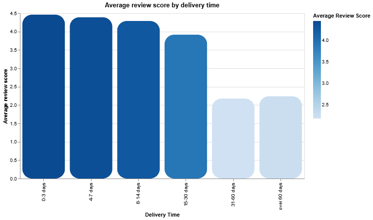
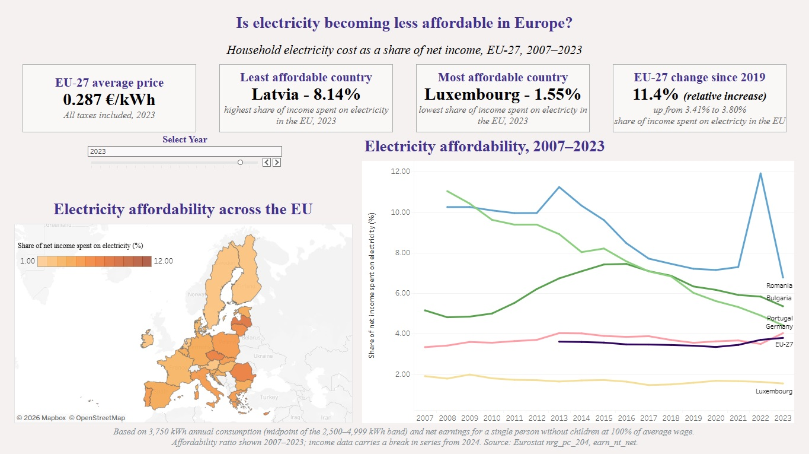
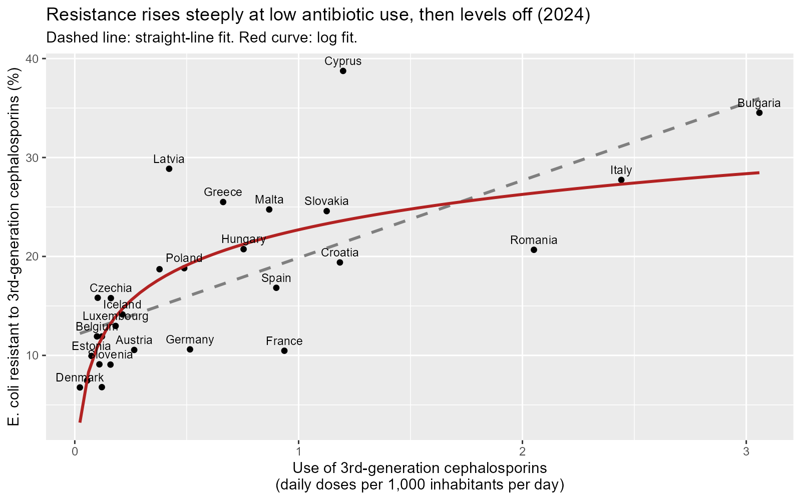
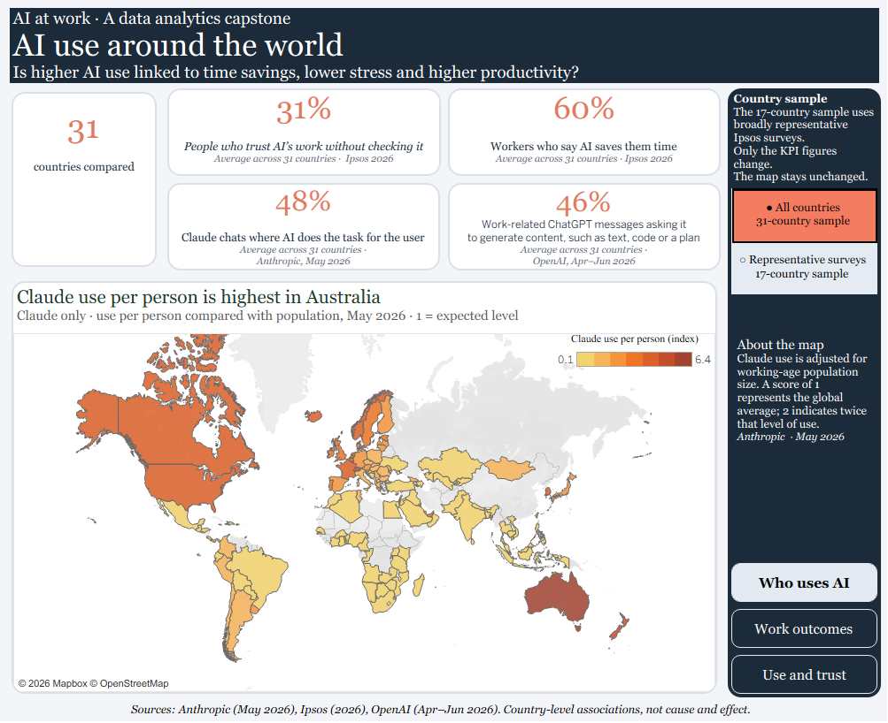

# Crinu Topalo – Data Analytics Portfolio

**Junior Data Analyst** · SQL · R · Python · Tableau · Data quality 
Strasbourg, France · Open to roles in Strasbourg and remote

[LinkedIn](https://www.linkedin.com/in/crinutopalo) · [Tableau Public](https://public.tableau.com/app/profile/crinu.topalo6593/vizzes) · [Medium](https://medium.com/@crinutopaloproject)

---

## About me

I'm a junior data analyst with a background in data quality. From 2014 to 2021, I worked as a freelancer on search evaluation, data annotation and localisation projects for the French-language market. That work taught me to follow detailed guidelines, check data carefully and stay consistent across thousands of decisions.

In 2026, I completed the **Google Data Analytics Professional Certificate** and built the four projects below. Each one starts with a real question, uses public data, and ends with findings, limitations and, where it makes sense, a recommendation.

I speak French, English (C2), Romanian and Russian.

---

## Projects

| # | Project | Question | Tools | Links |
|---|---|---|---|---|
| 1 | [**E-commerce reviews**](01_Olist_SQL_Bigquery) | Are delivery delays associated with low customer ratings? | SQL, BigQuery, Google Sheets | [Analysis](01_Olist_SQL_Bigquery) |
| 2 | [**EU electricity affordability**](02_Tableau_Electricity_Prices_and_Salaries) | How much of household income goes to electricity across the EU, and did it change after 2022? | Tableau | [Dashboard](https://public.tableau.com/views/EUElectricityAffordability20072023/Dashboard1) · [Article](https://medium.com/@crinutopaloproject/is-electricity-actually-less-affordable-in-europe-now-b718cd37a2aa) |
| 3 | [**Antibiotic use and resistance**](03_R_Antibiotic_Resistance) | Do EU countries that use more third-generation cephalosporins have more resistant *E. coli*? | R (tidyverse) | [Analysis](03_R_Antibiotic_Resistance) |
| 4 | [**AI at work**](04_AI_at_Work_Tableau_Google_Colab) | In countries where people use AI more, do workers save time, feel less stressed and produce more? | Python (Colab), Tableau | [Dashboard](https://public.tableau.com/app/profile/crinu.topalo6593/viz/AIatWorkTimeSavingsStressandProductivity/WhousesAI) · [Analysis](04_AI_at_Work_Tableau_Google_Colab) |

<table>
  <tr>
    <td width="50%"></td>
    <td width="50%"></td>
  </tr>
  <tr>
    <td align="center"><b>1.</b> Review score by delivery time</td>
    <td align="center"><b>2.</b> EU electricity affordability dashboard</td>
  </tr>
  <tr>
    <td width="50%"></td>
    <td width="50%"></td>
  </tr>
  <tr>
    <td align="center"><b>3.</b> Antibiotic use vs resistance, 2024</td>
    <td align="center"><b>4.</b> AI at work dashboard</td>
  </tr>
</table>

### Key findings

1. **E-commerce reviews:** across ~100,000 Olist orders, the average rating fell from **4.46/5** for deliveries in 0–3 days to about **2.2/5** for deliveries taking more than 30 days. Product category made a much smaller difference.
2. **EU electricity affordability:** the share of income spent on electricity varied widely between countries in 2023, from about **1.6% in Luxembourg** to about **8.1% in Latvia**. Over the long term, the main trend was convergence between countries rather than a general crisis.
3. **Antibiotic resistance:** in 2024, countries with higher consumption tended to have higher resistance (**Spearman's rho = 0.77, p < 0.001**, 28 countries). The association stayed positive in every year from 2005 to 2024.
4. **AI at work:** across 31 countries, higher AI use was linked to higher output per hour, but not to more reported time saved or less stress. None of the main results held after Holm correction in a smaller, more representative 17-country sample, so the findings depend on which countries are included.

These are associations between countries or groups, not proof of cause and effect. Each project README explains the data, method and limitations in detail.

---

## Skills

| Area | Tools and methods |
|---|---|
| **Data** | SQL (BigQuery), R (tidyverse), Python (pandas, SciPy – basic), Excel, Google Sheets |
| **Visualisation** | Tableau (dashboards, calculated fields, KPIs, maps), ggplot2 |
| **Analysis** | Data cleaning, joining multiple sources, validation against real-world figures, correlation and regression, robustness checks, multiple-testing correction |
| **Data quality** | Annotation, relevance evaluation, guideline-based review, localisation |
| **Tools** | GitHub, Google Colab / Jupyter, RStudio, AI assistants (Claude, ChatGPT, Copilot) |

---

## How I work

- **Start with a question:** every project begins with a business or research question, not with a chart.
- **Look at the raw data first:** check sizes, missing values and odd records before analysing.
- **Validate:** compare results with real-world benchmarks, not just internal consistency.
- **Be honest about limits:** small samples, missing data and correlation vs. causation are stated in each README.

## AI assistance

I used AI assistants (Claude, ChatGPT and Copilot) as a learning and support tool: to explain concepts, help debug code, troubleshoot Tableau and review my writing. I made the analytical decisions, ran the analyses, and checked the results against the data and the original sources. I can explain each step of every project.

---

## Certifications

- **Google Data Analytics Professional Certificate** – Google / Coursera, July 2026 · [Verify](https://coursera.org/verify/professional-cert/7LEYL60E7DYZ)
- **EF SET English Certificate – C2 Proficient (75/100)** – October 2026 · [Verify](https://cert.efset.org/en/WML6ip)

## Contact

📧 crinutopaloproject@gmail.com · 💼 [linkedin.com/in/crinutopalo](https://www.linkedin.com/in/crinutopalo)
